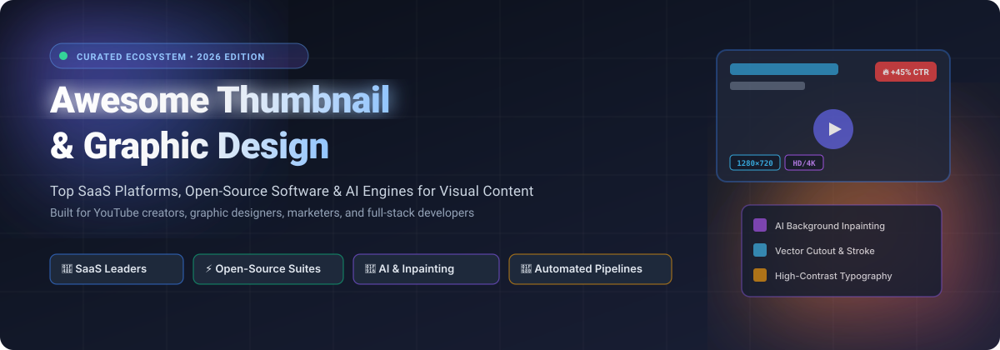
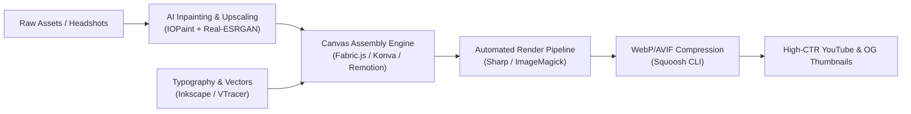

<p align="center">
  
</p>

<p align="center">
  <a href="https://github.com/ishandutta2007/Awesome-Awesome-Awesome"></a><a href="https://discord.gg/jc4xtF58Ve"></a>
  <a href="https://github.com/ishandutta2007/Awesome-Thumbnail-Graphic-Design/stargazers"></a>
  <a href="https://github.com/ishandutta2007/Awesome-Thumbnail-Graphic-Design/network/members"></a>
  <a href="https://github.com/ishandutta2007/Awesome-Thumbnail-Graphic-Design/pulls"></a>
  <a href="https://github.com/ishandutta2007/Awesome-Thumbnail-Graphic-Design/blob/main/LICENSE"></a>
  <a href="https://github.com/ishandutta2007"></a>
</p>

<h1 align="center">🎨 Awesome Thumbnail & Graphic Design 🚀</h1>

<p align="center">
  <strong>Curated Directory of Top SaaS Platforms, Open-Source Graphic Design Software, Canvas SDKs & AI Thumbnail Generation Engines</strong>
</p>

<p align="center">
  <em>Essential visual design tools, click-through-rate (CTR) optimization suites, vector editors, and programmatic rendering pipelines for YouTube creators, graphic designers, digital marketers, and developers.</em>
</p>

---

## 📑 Table of Contents

- [🌟 Overview & SEO Highlights](#-overview--seo-highlights)
- [📊 Sector Overview & Market Dynamics](#-sector-overview--market-dynamics)
- [💎 SaaS & Hosted Platforms](#-saas--hosted-platforms)
- [⚡ Open-Source GitHub Projects](#-open-source-github-projects)
  - [🏆 Top Repositories by Popularity](#-top-repositories-by-popularity)
  - [🛠️ Architectural Stacks for Developers](#️-architectural-stacks-for-developers)
- [🤝 How to Contribute](#-how-to-contribute)
- [📈 Star History](#-star-history)
- [💖 Support & Sponsorship](#-support--sponsorship)
- [⚖️ Disclaimer & Licensing](#️-disclaimer--licensing)

---

## 🌟 Overview & SEO Highlights

In the high-speed creator economy and digital advertising sphere, **thumbnails and visual hooks determine up to 90% of audience engagement and click-through rates (CTR)**. Whether you are creating 1280×720 YouTube video covers, high-conversion Open Graph (OG) social cards, promotional ad banners, or vector brand kits, selecting the right design tool directly impacts production velocity and creative output.

This curated collection indexes:
- 🎯 **SaaS Design Suites**: Turnkey cloud editors with stock libraries, generative AI assistants, and pre-built creator templates.
- 🔓 **Open-Source Graphic Applications**: Native vector and raster powerhouses providing zero-fee licensing and complete privacy.
- 🤖 **AI Inpainting & Upscaling Engines**: State-of-the-art tools for object removal, background generation, and resolution enhancement.
- 💻 **Programmatic Rendering & Canvas SDKs**: Headless APIs, React/Canvas libraries, and CLI engines for automated bulk thumbnail generation.

**Keywords**: `graphic-design`, `youtube-thumbnails`, `thumbnail-generator`, `canva-alternatives`, `figma-alternatives`, `open-source-photoshop`, `vector-graphics`, `ctr-optimization`, `ai-inpainting`, `canvas-sdk`, `image-processing`.

---

## 📊 Sector Overview & Market Dynamics

The global graphic design software and visual content creation market is valued at approximately **$4.8 billion in 2024–2025** and is projected to reach **$8.2+ billion by 2030**, expanding at a Compound Annual Growth Rate (CAGR) of **~9.4%**. Growth is intensely accelerated by the creator economy, programmatic social media marketing, and the mainstream adoption of multimodal generative AI.

From a competitive landscape perspective, the sector exhibits **bimodal concentration**:
1. **High Concentration at the Enterprise Core (Power-Law Oligopoly)**: Adobe (market cap ~$215B) and Canva (valuation ~$32B) command dominant global market share in general-purpose cloud design, corporate brand management, and commercial creative workflows.
2. **Dynamic Fragmentation at the Creator & Developer Edge**: Specialized creator workflows (such as YouTube thumbnail A/B testing, pixel art, procedural vector graphics, and headless Open Graph generation) remain **moderately fragmented**. High subscription fees and privacy considerations have catalyzed rapid migration toward **extensible open-source engines** (e.g., Penpot, ComfyUI, Remotion, Graphite, and Sharp), empowering engineering teams to build self-hosted, proprietary design microservices.

---

## 💎 SaaS & Hosted Platforms

The following hosted design platforms provide turnkey web and mobile editors, curated thumbnail templates, generative AI tools, and team collaboration features. 

> *Sorted descending by company valuation / market capitalization.*

| 🎨 Platform | 🏢 Valuation / Revenue | 💳 Starting Pricing | 🎁 Free Tier Limits & Trial Period | 🚀 Key Capabilities & Thumbnail Focus |
|:---|:---|:---|:---|:---|
| **[Adobe Express](https://www.adobe.com/express/)** | **$215B Market Cap** *(ADBE, ~$21.4B ARR)* | **$9.99 / month** *(or $99.99/year prepaid)* | **Free Forever Plan**: 25 generative AI credits/mo, thousands of free templates, basic photo editing tools, 5GB cloud storage, limited Adobe Fonts access. | Adobe Firefly generative AI, seamless integration with Creative Cloud libraries, instant background removal, and YouTube thumbnail presets. |
| **[Canva](https://www.canva.com/)** | **$32B Valuation** *(~$2.3B ARR, 190M+ MAU)* | **$14.99 / month** *(or $120.00/year for 1 user)* | **Free Forever Plan**: 1M+ free templates and media assets, 1,000+ fonts, 5GB cloud storage, drag-and-drop editor, up to 50 lifetime AI Magic Media uses. | Industry-standard drag-and-drop designer, extensive YouTube thumbnail templates, Magic Studio AI tools, brand kits, and bulk thumbnail creation. |
| **[Figma](https://www.figma.com/)** | **$12.5B Valuation** *(~$700M+ ARR)* | **$12.00 / editor / mo** *(billed annually at $144/yr; or $15/mo monthly)* | **Free Starter Plan**: 3 active Figma design files, 3 FigJam whiteboards, unlimited personal drafts, unlimited collaborators, 30-day version history. | Vector interface design, auto-layout, typography styles, collaborative multiplayer canvas, and rich community thumbnail templates/plugins. |
| **[Photoleap](https://www.photoleapapp.com/)** | **$1.8B Valuation** *(Lightricks Unicorn, $335M+ raised)* | **$9.99 / month** *(or $39.99/year ~$3.33/mo)* | **7-Day Free Trial** with unrestricted Pro features; Free tier offers basic filters, standard cropping, and 1 daily AI generation/export with watermark. | AI photo composite suite, background cutout, text-to-image effects, double exposure, and mobile-first creator thumbnail styling. |
| **[PicMonkey](https://www.picmonkey.com/)** | **$1.1B Market Cap** *(Parent: Shutterstock, NYSE: SSTK; ~$875M ARR)* | **$7.99 / month** *(Basic, billed annually at $72/yr; or $10.99/mo monthly)* | **7-Day Free Trial** with full high-res downloads; Free mode permits canvas editing and template browsing but requires trial/plan to export without watermark. | Photo touch-up tools, YouTube banner & thumbnail presets, background eraser, design overlays, and direct integration with Shutterstock stock assets. |
| **[Kittl](https://www.kittl.com/)** | **$180M Valuation** *($47M raised incl. Series B)* | **$10.00 / month** *(Pro, billed annually at $120/yr; or $15/mo monthly)* | **Free Forever Plan**: 20 AI generation credits, full template access, standard 72 DPI exports (attribution required for commercial use), 500KB cloud upload limit. | Advanced typography effects, vintage/modern banner templates, AI vector generation, texture masking, and high-impact thumbnail lettering. |
| **[Pixlr](https://pixlr.com/)** | **~$75M Revenue** *(Inmagine Group, 500M+ lifetime users)* | **$1.99 / month** *(Plus tier; Premium tier at $7.99/mo or $4.90/mo annual)* | **Free Forever Plan**: Ad-supported access to Pixlr X (express) & Pixlr E (advanced), 3 file saves/downloads per 24 hours, basic editing tools, 5 AI credits. | Web-first lightweight Photoshop alternative, AI cutout, generative fill, batch thumbnail resizing, and photo composite editing. |
| **[Visme](https://www.visme.co/)** | **~$35M ARR** *(Bootstrapped, 20M+ users)* | **$12.25 / month** *(Starter, billed annually at $147/yr; or $29/mo monthly)* | **Free Basic Plan**: 100MB cloud storage, access to standard visual templates, public web project sharing links, exports limited to JPG/PNG with Visme watermark. | Visual storytelling platform, infographic charts, presentation slides, data visualization, and animated social media graphics. |
| **[Snappa](https://snappa.com/)** | **~$4M ARR** *(Bootstrapped profitable SaaS)* | **$10.00 / month** *(Pro, billed annually at $120/yr; or $15/mo monthly)* | **Free Starter Plan**: 1 user, 6,000+ pre-made social/thumbnail templates, 5M+ royalty-free stock photos & graphics, strictly 3 downloads/exports per month. | Streamlined graphic maker for creators, social media dimension presets, one-click background remover, and fast YouTube thumbnail production. |
| **[Thumbnail Blaster](https://thumbnailblaster.com/)** | **~$1.5M ARR** *(Independent niche software)* | **$37.00 One-time Fee** *(Promotional standard license; $97 regular)* | **14-Day 100% Money-Back Guarantee** with instant full access upon order to 30 core templates, drag-and-drop thumbnail engine, and VIP video training. | Dedicated YouTube thumbnail generator, automated video title-to-thumbnail AI layout, split-testing module, and high-CTR color presets. |

---

## ⚡ Open-Source GitHub Projects

Open-source design software guarantees full data privacy, allows offline operation, removes recurring subscription overhead, and enables engineering teams to build automated custom pipelines.

### 🏆 Top Repositories by Popularity

> *Sorted descending by GitHub stargazer count. Badges link directly to each repository's stargazers page.*

1. **[AUTOMATIC1111/stable-diffusion-webui](https://github.com/AUTOMATIC1111/stable-diffusion-webui)** [](https://github.com/AUTOMATIC1111/stable-diffusion-webui/stargazers) `AGPL-3.0`  
   The definitive browser interface for Stable Diffusion. Extensively used by creators to synthesize custom thumbnail backgrounds, character renders, and surreal visual compositions via ControlNet and inpainting.

2. **[comfyanonymous/ComfyUI](https://github.com/comfyanonymous/ComfyUI)** [](https://github.com/comfyanonymous/ComfyUI/stargazers) `GPL-3.0`  
   Node-based, modular Stable Diffusion and Flux execution engine. Allows creators and developers to build programmatic, reproducible pipelines for generating high-resolution thumbnails, visual effects, and face swaps.

3. **[excalidraw/excalidraw](https://github.com/excalidraw/excalidraw)** [](https://github.com/excalidraw/excalidraw/stargazers) `MIT`  
   Virtual whiteboard with a signature hand-drawn style. Perfect for educational YouTube thumbnails, system architecture diagrams, tech tutorials, and sketch annotations.

4. **[remotion-dev/remotion](https://github.com/remotion-dev/remotion)** [](https://github.com/remotion-dev/remotion/stargazers) `Custom/Commercial`  
   Create videos and render dynamic, pixel-perfect thumbnails programmatically using React, HTML, CSS, and WebGL. Ideal for automated YouTube thumbnail generators and social preview workflows.

5. **[penpot/penpot](https://github.com/penpot/penpot)** [](https://github.com/penpot/penpot/stargazers) `MPL-2.0`  
   Open-source web-based design and prototyping suite positioned as the primary self-hosted alternative to Figma. Features SVG-native canvas, CSS grid/flexbox layout, components, and real-time multiplayer editing.

6. **[tldraw/tldraw](https://github.com/tldraw/tldraw)** [](https://github.com/tldraw/tldraw/stargazers) `Custom/Apache-2.0`  
   Collaborative digital canvas and drawing library built with React. Excellent for annotating graphics, constructing flow diagrams, and generating custom thumbnail illustrations.

7. **[upscayl/upscayl](https://github.com/upscayl/upscayl)** [](https://github.com/upscayl/upscayl/stargazers) `AGPL-3.0`  
   Free and open-source AI image upscaler for desktop (Linux, macOS, Windows). Upscales low-resolution stock images and webcam stills into crisp, 4K-ready assets for thumbnail composition using Vulkan and Real-ESRGAN.

8. **[mifi/lossless-cut](https://github.com/mifi/lossless-cut)** [](https://github.com/mifi/lossless-cut/stargazers) `GPL-2.0`  
   Lossless video and media trimmer. Used by video editors and YouTube creators to extract full-resolution, uncompressed video frames instantly at exact timestamps for thumbnail creation.

9. **[xinntao/Real-ESRGAN](https://github.com/xinntao/Real-ESRGAN)** [](https://github.com/xinntao/Real-ESRGAN/stargazers) `BSD-3-Clause`  
   Practical restoration algorithm for general images and digital artwork. Serves as the core AI engine powering many commercial and self-hosted image upscaling utilities.

10. **[carbon-app/carbon](https://github.com/carbon-app/carbon)** [](https://github.com/carbon-app/carbon/stargazers) `MIT`  
    Create and share beautiful images and syntax-highlighted snippets of your source code. Widely employed across developer YouTube channels, tech tutorials, and blog post thumbnails.

11. **[lovell/sharp](https://github.com/lovell/sharp)** [](https://github.com/lovell/sharp/stargazers) `Apache-2.0`  
    High-performance Node.js image processing library powered by libvips. Standard choice for server-side thumbnail generation, fast resizing, cropping, watermarking, and format conversion.

12. **[fabricjs/fabric.js](https://github.com/fabricjs/fabric.js)** [](https://github.com/fabricjs/fabric.js/stargazers) `MIT`  
    Powerful HTML5 canvas library providing an interactive object model, SVG-to-canvas parser, text styling, and layer transformations. The foundational engine behind numerous web-based thumbnail makers.

13. **[GraphiteEditor/Graphite](https://github.com/GraphiteEditor/Graphite)** [](https://github.com/GraphiteEditor/Graphite/stargazers) `Apache-2.0`  
    Modern 2D raster and vector graphics editor built with Rust and WebGPU. Features a non-destructive node-based procedural composition system designed for high-efficiency design workflows.

14. **[GoogleChromeLabs/squoosh](https://github.com/GoogleChromeLabs/squoosh)** [](https://github.com/GoogleChromeLabs/squoosh/stargazers) `Apache-2.0`  
    Browser and CLI image compression web app by Google Chrome Labs. Optimizes thumbnail file size to WebP, AVIF, and MozJPEG without perceptible quality degradation for ultra-fast web loading.

15. **[Sanster/IOPaint](https://github.com/Sanster/IOPaint)** [](https://github.com/Sanster/IOPaint/stargazers) `Apache-2.0`  
    Image inpainting and object removal suite powered by state-of-the-art AI models (LaMa, MAT, Stable Diffusion). Cleanly removes unwanted objects, tourists, or watermarks from thumbnail photo assets.

16. **[blender/blender](https://github.com/blender/blender)** [](https://github.com/blender/blender/stargazers) `GPL-3.0`  
    Professional 3D creation suite featuring modeling, sculpting, lighting, Grease Pencil 2D animation, and node compositing. Ideal for rendering striking 3D typography and cinematic characters for 3D thumbnails.

17. **[ImageMagick/ImageMagick](https://github.com/ImageMagick/ImageMagick)** [](https://github.com/ImageMagick/ImageMagick/stargazers) `Apache-2.0`  
    Battle-tested CLI and library for automated image manipulation, compositing text onto backgrounds, converting color profiles, and generating bulk thumbnails in CI/CD and shell pipelines.

18. **[konvajs/konva](https://github.com/konvajs/konva)** [](https://github.com/konvajs/konva/stargazers) `MIT`  
    2D HTML5 canvas JavaScript framework with high-performance desktop and mobile support. Provides layer management, shape animations, drag-and-drop, and filters for custom web design editors.

19. **[darktable-org/darktable](https://github.com/darktable-org/darktable)** [](https://github.com/darktable-org/darktable/stargazers) `GPL-3.0`  
    Open-source photography workflow application and non-destructive RAW developer. Essential for color grading creator portraits, contrast adjustment, and camera RAW processing prior to thumbnail layout.

20. **[KDE/krita](https://github.com/KDE/krita)** [](https://github.com/KDE/krita/stargazers) `GPL-3.0`  
    Professional digital painting and illustration studio. Features advanced brush engines, vector text tools, wrap-around modes, and layer management for custom digital art and painted thumbnail elements.

21. **[Orama-Interactive/Pixelorama](https://github.com/Orama-Interactive/Pixelorama)** [](https://github.com/Orama-Interactive/Pixelorama/stargazers) `MIT`  
    Free and open-source 2D sprite editor and pixel art suite built with Godot. Perfect for retro-gaming YouTube thumbnails, pixel lettering, and stylized sprite illustrations.

22. **[opentoonz/opentoonz](https://github.com/opentoonz/opentoonz)** [](https://github.com/opentoonz/opentoonz/stargazers) `BSD-3-Clause`  
    Full-featured 2D animation software used by Studio Ghibli. Capable of vector and raster drawing, compositing, and rendering animated thumbnail assets.

23. **[visioncortex/vtracer](https://github.com/visioncortex/vtracer)** [](https://github.com/visioncortex/vtracer/stargazers) `MIT`  
    High-speed raster-to-vector image converter written in Rust. Converts bitmap logos, photos, and sketches into scalable SVG graphics for crisp thumbnail typography and vector badges.

24. **[GNOME/gimp](https://github.com/GNOME/gimp)** [](https://github.com/GNOME/gimp/stargazers) `GPL-3.0`  
    GNU Image Manipulation Program — the veteran open-source raster image editor. Delivers full photo retouching, multi-layer compositing, masks, color correction, and plugin extensibility.

25. **[NatronGitHub/Natron](https://github.com/NatronGitHub/Natron)** [](https://github.com/NatronGitHub/Natron/stargazers) `GPL-2.0`  
    Node-based digital compositor for visual effects and motion graphics. Useful for complex multi-pass rendering, keying green screens, and cinematic thumbnail backgrounds.

26. **[RawTherapee/RawTherapee](https://github.com/RawTherapee/RawTherapee)** [](https://github.com/RawTherapee/RawTherapee/stargazers) `GPL-3.0`  
    Cross-platform RAW photo processing software utilizing a 96-bit floating-point processing engine for non-destructive color tuning and exposure correction.

27. **[PintaProject/Pinta](https://github.com/PintaProject/Pinta)** [](https://github.com/PintaProject/Pinta/stargazers) `MIT`  
    Lightweight, easy-to-use drawing and photo editing program modeled after Paint.NET. Ideal for fast crop, annotation, arrow overlays, and basic thumbnail creation.

28. **[vercel/og-image](https://github.com/vercel/og-image)** [](https://github.com/vercel/og-image/stargazers) `MIT`  
    Open Graph social card and dynamic thumbnail generation service utilizing serverless functions and Puppeteer/HTML rendering.

29. **[inkscape/inkscape](https://github.com/inkscape/inkscape)** [](https://github.com/inkscape/inkscape/stargazers) `GPL-2.0`  
    The premier open-source vector graphics editor. Native SVG support, bezier path editing, text-on-path, gradient meshes, and extensive extension ecosystem for logos, badges, and vector thumbnails.

30. **[Figma-Linux/figma-linux](https://github.com/Figma-Linux/figma-linux)** [](https://github.com/Figma-Linux/figma-linux/stargazers) `GPL-2.0`  
    Electron-based desktop application for Figma running natively on Linux distributions with local font support and system tray integration.

31. **[tannerhelland/PhotoDemon](https://github.com/tannerhelland/PhotoDemon)** [](https://github.com/tannerhelland/PhotoDemon/stargazers) `BSD-3-Clause`  
    Portable, zero-install photo editor for Windows. Runs completely standalone from a USB drive with comprehensive layer support, curves, content-aware sizing, and batch processing.

32. **[raycast/ray-so](https://github.com/raycast/ray-so)** [](https://github.com/raycast/ray-so/stargazers) `MIT`  
    Open-source web application for generating stylish syntax-highlighted code snippets with customizable backgrounds and window frames for technical content covers.

33. **[synfig/synfig](https://github.com/synfig/synfig)** [](https://github.com/synfig/synfig/stargazers) `GPL-3.0`  
    Industrial-strength 2D vector animation studio. Allows timeline tweening, morphing vector layers, and rendering expressive graphic elements.

---

### 🛠️ Architectural Stacks for Developers

Developers looking to build automated thumbnail generators, in-house design portals, or embeddable design canvases can combine these open-source building blocks:



- **🎨 Embeddable Web Canvas**: Use **[Fabric.js](https://github.com/fabricjs/fabric.js)** or **[Konva](https://github.com/konvajs/konva)** to provide drag-and-drop layers, text styling, and SVG import within your web application.
- **⚡ Server-Side Bulk Rendering**: Pair **[Sharp](https://github.com/lovell/sharp)** (Node.js) or **[ImageMagick](https://github.com/ImageMagick/ImageMagick)** with **[Remotion](https://github.com/remotion-dev/remotion)** to automatically synthesize customized video thumbnails at scale from dynamic API inputs.
- **🤖 Generative AI Pipeline**: Orchestrate **[ComfyUI](https://github.com/comfyanonymous/ComfyUI)** via headless REST APIs with **[IOPaint](https://github.com/Sanster/IOPaint)** for automated background synthesis and artifact cleaning.

---

## 🤝 How to Contribute

Contributions are warmly welcomed! Help expand this directory by suggesting top-tier SaaS tools, active open-source projects, or developer frameworks:

1. 🍴 **Fork the repository** to your GitHub account.
2. 🌿 **Create a feature branch**:
   ```bash
   git checkout -b feature/add-new-design-tool
   ```
3. 📝 **Add your entry** under the appropriate section following the established format:
   - Include platform/project name, official URL or GitHub link.
   - For SaaS: add exact starting tier pricing, free tier/trial limits, and company size.
   - For Open-Source: add GitHub star badge `[](https://github.com/{owner}/{repo}/stargazers)` and SPDX license tag.
4. 📬 **Submit a Pull Request** with a concise summary of the addition.

---

## 📈 Star History

[](https://star-history.dera.page/#ishandutta2007/Awesome-Thumbnail-Graphic-Design&type=date&legend=top-left)

---

## 💖 Support & Sponsorship

If you find this curated ecosystem directory helpful for your creative workflow or development stack, please consider supporting the project:

- ⭐ **Star this repository** to improve discoverability for creators worldwide!
- 🍴 **Fork and share** with your design and creator communities.
- ☕ **Sponsor the Maintainer**: Support ongoing curation, open-source tooling, and maintenance via the **[GitHub Sponsors Dashboard](https://github.com/sponsors/ishandutta2007)**.

<p align="center">
  <a href="https://github.com/sponsors/ishandutta2007">
    
  </a>
</p>

---

## ⚖️ Disclaimer & Licensing

- **Community Curated**: This repository is an independent, community-driven resource and is not sponsored, endorsed, or affiliated with Adobe, Canva, Figma, Google, or any referenced vendor.
- **Trademarks**: Product names, logos, and brands are the property of their respective trademark holders.
- **License**: Content is released under the **[MIT License](LICENSE)**.
